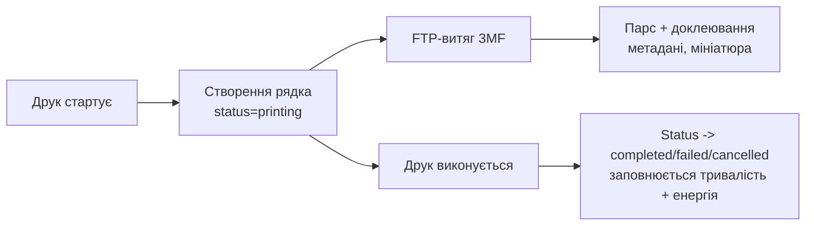

# Архівування друку

BamDude автоматично архівує кожен друк -- файл 3MF, витягнуту мініатюру, розпарсені метадані, дані про енергію та таймінг, і повне походження аж до файлу бібліотеки чи елемента черги, який його породив. Архіви -- це "система запису" того, що було реально надруковано: дедуп, статистика використання файлів бібліотеки, диспатчер черги та обкладинка на сторінці принтера -- усі вони читають з цієї таблиці.

---

Після підтвердження запуску у вікні **Редагувати архів** видно, який колір був у файлі та який був завантажений, для кожного каналу з підтвердженою різницею. Для порівняння використовуються захоплена плита й фізична котушка, вибрана під час відправки.

## :material-archive: Як працює архівування

Коли друк стартує, BamDude створює рядок `print_archives`, який віддзеркалює запуск від початку до кінця, а вже потім витягує 3MF з SD-картки принтера через FTP і доклеює його до цього рядка:

**Спершу рядок, файл наздоганяє.** Витягти 3MF назад із принтера -- не швидко: заміряно на P1S, 22 МБ ішли 8m40s під час друку, бо файл читається з тієї самої SD-картки, з якої друкує принтер. (Той самий витяг на простої зайняв 96 секунд.) Створення рядка після цього означало, що друк не існував у BamDude ніде, доки завантаження не завершиться -- ні запису в Архівах, ні сповіщення про старт, а черга й далі показувала принтер вільним. Гірше: показання розетки, відносно якого рахується енергія друку, бралося наприкінці того завантаження, тож усе спожите за цей час не рахувалося -- включно з розігрівом столу.

Якщо FTP-витяг не вдається, рядок просто лишається з `file_path = ""` -- див. [Відновлення завантаження 3MF](#відновлення-завантаження-3mf) нижче. Диспатчер створює рівно один архів на фізичний друк і прив'язує `PrintQueueItem.archive_id` до нього в межах однієї транзакції (тож між планувальником та диспатчером нема гонок, які створювали б рядки-дублікати). Друки, які BamDude диспатчив сам, мають свій рядок ще до завантаження файлу на принтер -- тож схема вище описує друки, запущені деінде: з екрана принтера, через **Send to Printer** у слайсері, з Bambu Cloud.

!!! warning "3MF має бути там, куди BamDude дістане"
    BamDude витягує його з SD-картки принтера через FTP, тож на більшості принтерів картка має бути встановлена. Без неї можна записати лише метадані, що повідомляються через MQTT; мініатюри й 3D-перегляд недоступні.

    На **X2D, P2S і сімействі H2** файл також витягується з вбудованого сховища принтера, коли на картці нічого немає — включно з друками, запущеними з екрана самого принтера, які інакше лишили б архів без нічого.

!!! note "TLS-квірк прошивки X2D / P2S (обробляється автоматично)"
    Деякі прошивки спотикаються об дефолтний TLS 1.3 сучасного Python на FTPS-каналі — X2D повністю фейлить implicit-FTPS handshake, P2S ловить баг session-reuse — через що їхні картки архіву лишались порожніми (без філаменту / шарів / MakerWorld-лінка / мініатюри). BamDude обмежує FTPS-сесію до TLS 1.2 для цих моделей, тож завантаження 3MF на старті друку з'єднується і архів наповнюється. Налаштувань не треба.

---

## :material-database-outline: Що архівується

Кожен рядок архіву несе файл, розпарсені метадані, стан запуску та повне походження аж до того, що його породило.

=== "Файл + мініатюра"

    | Поле | Опис |
    |-------|-------------|
    | `file_path` | Копія 3MF за `data/archive/<printer_id>/<timestamp>_<name>/<filename>.3mf`. Порожній рядок означає, що 3MF не вдалося витягнути (fallback-рядок) або його почистила політика зберігання. |
    | `file_size` | Байти на диску. |
    | `thumbnail_path` | Витягнуте PNG зі слайсера. Лишається навіть після того, як 3MF почистило. Для 3MF, нарізаних через Docker-сайдкар слайсера — який пропускає desktop-only рендер plate-PNG — BamDude генерує відсутні мініатюри плит на сервері (ізометричний рендер вбудованої моделі кольору Bambu-green, 512 px + 128 px, з тим самим світлом і ракурсом, що й STL-мініатюри Менеджера файлів), тож картка архіву не порожня. Плиту з багатьох копій читаємо по одній деталі й спрощуємо рівномірно; плита, що й після цього перевищує ліміт граней прев'ю, лишається без картинки, нічого не затримуючи. |
    | `source_3mf_path` | Оригінальне проєктне 3MF при завантаженні зі слайсера (окреме від диспатченої копії). |

=== "Метадані слайсера"

    | Поле | Опис |
    |-------|-------------|
    | `print_name` | Ім'я друку, задане слайсером. |
    | `filament_type`, `filament_color` | Основний філамент(и) друку. **Колір** береться з котушки інвенторі, завантаженої на слот AMS (по-слотово), з відкатом на колір зі слайсера для слотів без заасайненої котушки. |
    | `filament_used_grams` | Загальна кількість грамів за оцінкою слайсера. |
    | `layer_height`, `total_layers` | Геометрія шарів. |
    | `nozzle_diameter`, `nozzle_temperature`, `bed_temperature` | Уставки хотенду / столу. |
    | `print_time_seconds` | Оцінка слайсера. |
    | `actual_time_seconds`, `time_accuracy` | Реальна тривалість (`completed_at − started_at`) і точність оцінки (%), записуються для завершених друків і бекфіляться по історії. |
    | `sliced_for_model` | Модель принтера, під яку було нарізано 3MF, витягається з метаданих проєкту. |
    | `makerworld_url`, `designer` | Авто-витягуються з 3MF, коли присутні. |

=== "Стан запуску"

    | Поле | Опис |
    |-------|-------------|
    | `status` | `printing`, `completed`, `failed`, `aborted`, `cancelled`, `stopped` або застарілий `archived`. Див. [бейджі статусу](#бейджі-статусу-архіву) і [зміну стану вручну](#changing-a-prints-status-by-hand). |
    | `outcome_checked_at` | Коли хтось перевірив, що вийшло з друку, — див. [Перевірка результату друку](#checking-a-prints-result). Порожнє для завершеного друку, на який ще ніхто не глянув. |
    | `started_at`, `completed_at` | Wall-clock межі запуску (NULL, доки не настануть). |
    | `failure_reason` | Короткий ключ причини (напр. `layerShift`, `filamentRunout`, `userCancelled`). Порожній, коли принтер не дав розпізнаваної причини. |
    | `error_message` | Докладна діагностика від диспатчера / планувальника -- показується при наведенні на бейдж. |
    | `energy_start_kwh`, `energy_kwh`, `energy_cost` | Енергія на друк зі смарт-розетки принтера. `energy_start_kwh` фіксується на старті друку, щоб дельта пережила перезапуск бекенду посеред друку. `energy_cost` — це енергія за [ціною електроенергії свого часу](energy.md#калькуляція-cost). |
    | `wear_cost`, `wear_rate` | [Знос принтера](stats.md#знос-принтера), віднесений на друк, — його виміряна тривалість за погодинною ставкою принтера — і застосована ставка. Обидва порожні, якщо принтер не мав ставки або тривалість не виміряно. |

=== "Походження"

    | Поле | Опис |
    |-------|-------------|
    | `printer_id` | Який принтер його породив. Незмінний факт друку: його не можна змінити ні в редакторі, ні через API. |
    | `library_file_id` | Рядок `library_files`, з якого диспатчили цей архів. NULL для зовнішніх друків (з екрану принтера, з хмари, ручний старт зі SD). |
    | `project_id` | Опційний проєкт, до якого приписано архів. |
    | `created_by_id` | Користувач, який ініціював друк. |
    | `subtask_id` | Ідентифікатор subtask, призначений принтером, спостережений у MQTT push_status -- використовується як швидкий ключ зіставлення в `on_print_start`. |
    | `queue_id` | Рядок `printer_queues`, до якого належить архів (кожен архів має один -- зовнішні друки відкочуються на дефолтну чергу принтера, щоб запити статистики їх бачили). |
    | `batch_id` | UUID, спільний для всіх елементів черги, диспатчених разом; виживає очистку черги, тож "скільки з партії X завершилось?" і далі працює після того, як живі рядки черги зникли. |

=== "Ланцюжок походження"

    | Поле | Опис |
    |-------|-------------|
    | `content_hash` | SHA256 байтів, які реально лежать у директорії архіву. |
    | `source_content_hash` | SHA256 chain-root (непатченого) джерела. **Завжди заповнено**: коли chain-предка немає, цей архів стає chain-root і колонка засіюється його ж `content_hash`. Патчені варіації library-файлу успадковують це з library-рядка. Міграція **m039** бекфілить legacy-NULL до тієї самої інваріанти. |
    | `applied_patches` | JSON-список патчів, які пайплайн диспатчу застосував перед завантаженням, — прості ідентифікатори й об'єкти-описи поруч, напр. `["mesh_mode_fast_check_off", {"name": "gcode_injection", "plate_id": 2}]`. API повертає його точно таким, як записано. Інформативно — ніколи не використовується для висновків про стан файлу на диску. |

=== "Метадані skip-objects"

    Зберігається всередині `extra_data` (JSON):

    | Ключ | Опис |
    |-----|-------------|
    | `printable_objects` | Словник `{ id: name }` з 3MF -- заповнюється і для модалки, і для викликів `M623` skip-objects. |
    | `gcode_label_objects` | Чи слайсер записав ідентифікатори по об'єктах у gcode. Bambu Studio не емітить це поле, тож відсутність → `True` (дефолт BS). OrcaSlicer пише його явно. |
    | `exclude_object` | Чи слайсер увімкнув виключення об'єктів у профілі друку. |

    Кнопка skip-objects у в'юшці принтера потребує, щоб **обидва** `gcode_label_objects` та `exclude_object` були true -- інакше відправка `M623` впаде на прошивці (gcode не має маркерів по об'єктах).

    !!! tip "Користувачам OrcaSlicer"
        OrcaSlicer постачається з обома прапорцями **off** за замовчуванням. Увімкніть **Print Settings → Others → Label objects** *і* **Exclude objects** *перед* нарізанням. Передрізання обов'язкове -- ці прапорці не можна перемкнути на вже нарізаному 3MF. Користувачам Bambu Studio робити нічого не треба; дефолти там уже коректні.

---

## :material-tag-text: Бейджі статусу архіву

Сторінка Архівів рендерить маленьку пігулку статусу на кожній картці. Звичний випадок (завершений друк) не показує нічого -- бейдж з'являється лише тоді, коли відбувається щось цікаве.

| Бейдж | Статус | Значення |
|-------|--------|---------|
| :material-loading: синій (пульсує) | `printing` | Друк зараз виконується на принтері. Клік → перехід на сторінку принтера. |
| (немає) | `completed` | Друк завершився успішно. Без бейджа -- щоб сітка лишалась чистою. |
| :material-alert-circle: червоний | `failed` | Принтер повідомив, що друк не вдався, або завдання так і не стартувало. Друк, скасований на екрані самого принтера, теж закінчується як `failed` — із причиною `userCancelled`. Наведіть на бейдж, щоб побачити причину збою та `error_message`. |
| :material-cancel: червоний | `cancelled` | Людина зупинила друк із BamDude — з картки принтера, з черги, з Telegram-бота, через webhook чи з діалогу HMS, — або завдання скасували до старту. Причина — `userCancelled`. Той самий червоний стиль, що й у `failed`. |
| :material-cancel: червоний | `aborted` | Принтер закінчив друк, не повідомивши ні про завершення, ні про збій. У статистиці рахується разом із `failed`. |
| :material-cancel: червоний | `stopped` | Статус зі старіших версій. BamDude більше його не записує; друки, що його мають, і далі його показують і рахуються разом із `cancelled`. |
| :material-archive-outline: сірий | `archived` | Статус зі старіших версій для файлу, який зареєстрували, але не друкували. BamDude більше його не записує; рядки, що його мають, зберігають сірий бейдж. |

### Зміна стану друку вручну { #changing-a-prints-status-by-hand }

Поле **Стан** у діалозі редагування пропонує завершальні стани під їхніми власними назвами — **Завершено**, **Невдалий**, **Перервано** і **Скасовано** — і відкривається на справжньому стані друку (друк, збережений як **Зупинено**, так і показується). Статистика рахує **Невдалий** і **Перервано** як збої, а **Скасовано** і **Зупинено** тримає у власному [кошику скасованих](stats.uk.md#скасовані-друки-мають-власний-bucket), тож обирайте той, що каже, що сталося насправді.

- **«Друкується» ніколи не ставиться вручну.** Цей стан належить друку, який зараз іде: поле його не пропонує, а API відмовляє.
- **Стан друку, що ще триває, заблоковано.** Поле показується вимкненим із приміткою *Цей друк ще триває — його статус визначає принтер, тут його змінити не можна.* Друк закриває власний звіт принтера.
- **Зміна на «Завершено» очищає причину помилки** й деталі помилки — завершений друк не зберігає «скасовано користувачем».
- **Вільний залишок іде за зміною.** Для друку, не підшитого до жодного замовлення: вихід зі стану **Завершено** забирає деталі цього друку з полиці виробу, а вхід у нього зараховує придатні — див. [Друки без замовлення](projects.uk.md#друки-без-замовлення). Якщо ці деталі вже використано, стан однаково змінюється, а редактор каже, що запас треба виправити вручну на сторінці виробу.

---

## :material-check-circle-outline: Перевірка результату друку { #checking-a-prints-result }

Завершений друк несе позначку **Не перевірено** на своїй картці архіву та в рядку списку, доки хтось не гляне, що зійшло зі столу. Позначка зникає, коли стається будь-що з цього:

- **Для друку записано брак** — будь-яким зі [способів його записати](../scenarios/recording-defects.uk.md), і нуль теж є відповіддю.
- Натиснуто **Без браку** — у меню друку, у діалозі його редагування або для кількох друків одразу в режимі вибору.
- **Стіл замінено автоматично** — на принтері у [swap mode](swap-mode.uk.md), коли макрос зміни столу відповів успіхом або власна послідовність заміни у файлі очистила стіл. Такий друк зі столу ніхто не знімає, тож його в цю мить вважають перевіреним, без браку. Невдала чи [утримана](swap-mode.uk.md#утримана-заміна-столу) заміна, заміна, врегульована вручну, і друк, запущений з екрана принтера чи слайсера, позначку лишають: до принтера однаково хтось має підійти й там оцінити друк. Брак можна записати й пізніше — в архіві або кнопками Telegram.

Фільтр **Неперевірені** у шапці Архівів показує лише ті друки, що ще чекають.

Це не вердикт «придатний / непридатний». Чи придатні деталі — це кількість браку, і позначка не змінює ні цієї кількості, ні жодної статистики: вона лише каже, що хтось подивився. Неперевіреним буває тільки завершений друк: невдалий, скасований чи той, що ще триває, — ніколи, як і калібрувальний. Друки, які вже були завершені, коли BamDude почав вести цю позначку, вважаються перевіреними.

Щоб позначити друк, потрібне право його редагувати (`archives:update_own` для власних друків, `archives:update_all` для будь-яких). Необов'язкове нагадування про друки, які лишаються неперевіреними, описано в [Сповіщення → Результат не перевірено](notifications.uk.md#result-not-checked), а Telegram-бот [дає відповісти на нього кнопками й реакціями](telegram-bot.uk.md#активні-сповіщення).

| API | |
|---|---|
| `POST /api/v1/archives/{id}/outcome-checked` | Позначити завершений друк перевіреним, без браку. `409` для друку, який не завершено; повторна позначка — не помилка. |
| `GET /api/v1/archives/?outcome=unchecked` | Лише друки, результат яких ніхто не перевірив. |
| `outcome_checked_at`, `outcome_unchecked` | У кожній відповіді з архівом: коли результат перевірено і чи цей друк ще чекає. |

---

## :material-filter-variant: Колекції { #collections }

Перший випадний список у панелі фільтрів Архівів вибирає одну колекцію — готовий зріз списку:

| Колекція | Показує |
|---|---|
| **Усі** | Кожен архів. |
| **Останні 24 години** | Архіви, створені за останні 24 години. |
| **Цей тиждень** | Архіви, створені за останні 7 днів. |
| **Цей місяць** | Архіви, створені від першого дня поточного місяця. |
| **Обрані** | Архіви, позначені зіркою. |
| **Друковані** | Друки, що закінчилися, з будь-яким результатом — усе, крім тих, що ще друкуються. |
| **Невдалі друки** | Друки, що не завершилися: невдалі, перервані, скасовані й зупинені. |
| **Дублікати** | Архіви, вихідний файл яких друкували більше одного разу. |

Активна одна колекція за раз, і вона поєднується з полем пошуку та іншими фільтрами.

---

## :material-content-copy: Дедуплікація та ланцюжок походження

BamDude дедуплікує архіви за **source** content-хешем, а не просто за байтами на диску.

Причина: пайплайн диспатчу може пропатчити 3MF перед завантаженням -- наприклад, закоментувати команди `M970`/`M970.3` (vibration-probe), коли тогл "mesh-mode fast check" для друку вимкнений. Пропатчений файл має інший `content_hash`, ніж оригінал, тож наївний хеш-дедуп трактував би кожну патчену варіацію як новий дизайн.

`source_content_hash` це вирішує:

- Коли BamDude диспатчить пропатчений друк, він зберігає SHA256 **непатченого** джерела в `source_content_hash`, а SHA256 байтів, що приземлились на SD, -- у `content_hash`.
- On-disk файл за `file_path` -- **завжди** непатчений оригінал. Патчені байти живуть тільки в `/tmp/bamdude_patch_*` на час FTP-завантаження і прибираються диспатчером; `archive/` ніколи не тримає патчену варіацію. Саме це дозволяє reprint'у запускати патчер заново на кожне завдання й перемикати `mesh_mode_fast_check` / gcode-injection в обидва боки -- регексп `M970` у патчера матчить тільки uncommented-рядки і не зміг би зняти раніше зашитий патч, якби on-disk джерело було post-patch.
- Запити дедупу використовують `effective_hash = COALESCE(source_content_hash, content_hash)`. Кожен новий архів заповнює `source_content_hash` (chain-root або self-seed), тож `effective_hash` читає `source_content_hash` напряму; `COALESCE` лишається як defence-in-depth.
- Reprint з наявного архіву копіює непатчений файл у свіжу директорію архіву -- новий `content_hash`, якщо новий запуск патчиться інакше, але той самий `source_content_hash`, тож історія reprint-ів лишається прив'язаною до оригінального дизайну.
- Зовнішні друки (стартовані з екрану принтера / з хмари / ручний старт зі SD) отримують один SELECT-запит при створенні архіву: якщо будь-який попередній архів на **будь-якому** принтері збігається за `content_hash` або `source_content_hash`, ланцюжок успадковується.

Сторінка Архівів виставляє фільтр "duplicates", який групує рядки за цим ефективним хешем. Бейдж "оригінальний друк", лінк `original_archive_id`, список дублікатів у detail-ендпоінті, і лічильники `print_count` для файлів бібліотеки -- усі прив'язуються на `source_content_hash`, з `content_hash` лише як defence-fallback для legacy-NULL рядків. Наслідок: непатчений запуск на принтері A + запуск з вимкненим mesh-mode на принтері B того самого library-файлу групуються в одному бейджі **і** ділять один on-disk файл (див. нижче).

### Cross-printer file-on-disk дедуп

Коли BamDude архівує друк, чий `effective_hash` збігається з наявним архівом на **будь-якому** принтері, новий рядок архіву ре-юзає on-disk шлях замість писати ще одну копію. Збіг -- по chain-root хешу (`COALESCE(source_content_hash, content_hash)`): кожен рядок, що ділить непатчене походження, ділить один on-disk файл, незалежно від того, які патчі застосував кожен окремий диспатч. Ефект: друк того ж library-файлу на N принтерах із M різними комбінаціями патчів зберігає **одну** копію на диску + N×M рядків архіву. `delete_archive` ref-каунтує спільні `file_path` і прибирає байти лише коли видаляється останній посилаючий рядок. Той самий дедуп працює і в `attach_3mf_to_archive` (background download-retry) -- fallback-архів, чий 3MF приходить пізніше, приєднається до наявного ланцюжка замість того, щоб писати на диск (патчені) байти, скачані з принтера, коли непатчена копія вже існує.

Якщо ви апгрейдитесь з pre-0.4.2 встановлення, де в `archive/` могли лишитися патчені копії з прошлої семантики, запустіть `python scripts/prune_orphan_archive_files.py` (за замовчуванням dry-run, `--apply` для видалення) -- скрипт реконсилює директорію проти поточних DB-references.

!!! info "Міграції m009 + m039"
    `source_content_hash` та `applied_patches` додані в m009. Міграція **m039** бекфілить `source_content_hash = content_hash` для legacy-NULL рядків, щоб always-populated інваріанта трималась через апгрейд.

---

## :material-content-save-move: Зберегти надрукований файл назад у бібліотеку

3MF архіву можна скопіювати в бібліотеку з меню самого архіву — обираєте теку, і файл потрапляє туди прочитаним так само, як при завантаженні: з метаданими, тамбнейлом, поплитними даними й бейджами, а не безіменним файлом.

⚠️ **Зберегти той самий друк двічі не створює другої копії.** Бібліотека впізнає однаковий вміст і віддає ту копію, що вже є, — і каже про це, а не вдає, ніби щось записала.

⚠️ **Архів може не мати файлу для копіювання.** Друк, запущений з екрана самого принтера, чий 3MF не вдалося витягнути, має справжній рядок архіву й порожній файл — дія це пояснює, а не тихо збоїть. Те саме стосується передруку й відкриття в слайсері.

⚠️ **Swap-декларація друку переходить разом із файлом** ([Swap-режим](swap-mode.md)). Це власний запис архіву, звірений із байтами, які справді скопійовано, — ніколи не вгадується з назви файла. Архів із невідомою декларацією відхиляється, як і файл, що вже є в бібліотеці з протилежною декларацією; копія в бібліотеці лишається як є, і сам архів теж.

Зовнішні теки лише для читання в списку не показуються: бібліотека відмовляється в них писати, а пропонувати вибір, який не спрацює, гірше, ніж не пропонувати.

---

## :material-folder-multiple-outline: Прив'язка до файлів бібліотеки

Коли ви друкуєте з файлового менеджера, отриманий архів несе `library_file_id`, що вказує на джерельний рядок бібліотеки. Сам рядок бібліотеки натомість несе поточну статистику:

- **`print_count`** -- кількість *завершених* друків з цього файлу. Невдалі, скасовані та перервані запуски не рахуються.
- **`last_printed_at`** -- мітка часу останнього завершеного друку.

Вони оновлюються наживо, коли друк завершується, і були ретроактивно бекфілнуті з історії архівів при першому завантаженні міграції m014 (найстаріший збіжний рядок бібліотеки виграє, коли кілька файлів ділять один хеш, тож реімпорти не крадуть атрибуцію).

У файловому менеджері сортуйте за **most printed** або **least recently printed**, щоб знайти очевидних кандидатів на прибирання з бібліотеки.

!!! note "Зовнішні друки не прив'язуються"
    Друки, стартовані прямо з екрану принтера, з Bambu Cloud або з ручного старту зі SD, мають `library_file_id = NULL`. Хеш ланцюжка походження все одно їх дедупає, але вони не інкрементують статистику бібліотеки -- ця статистика відображає "друки, диспатчені через BamDude", а не "друки, які випадково використали цей дизайн".

---

## :material-cloud-download: Відновлення завантаження 3MF

Кожен рядок архіву починається з `file_path = ""` і отримує свій 3MF, щойно BamDude витягне його з принтера. Цей витяг може не вдатися -- принтер повільний, мережа смикається, файл уже переміщено на SD, шлях не збігається. Коли так стається, рядок лишається з порожнім `file_path` і додатково отримує `extra_data["no_3mf_available"] = True` разом з `extra_data["no_3mf_reason"]` -- чому витяг не вдався (див. банер нижче), -- і заповнюється ретроактивно.

!!! tip "Обмеження на розмір 3MF немає -- `ftp_timeout` ловить застряглу передачу, а не повільну"
    3MF друку йде назад через ту саму SD-картку, з якої друкує принтер, тож швидкість залежить від того, чим принтер зайнятий: 231 КБ/с на простої P1S і 43 КБ/с на тому ж, що друкує. `ftp_timeout` діє на окрему сокет-операцію, а не на все завантаження, тож це не **обмеження за розміром файлу**: зʼєднання, яке замовкло, обривається за вказані секунди, а те, що продовжує віддавати дані, дадуть докачати. Завантаження **на** принтер обмежене окремо -- 10 хвилинами, і `ftp_timeout` на це не впливає.

!!! note "Порожній `file_path` і `no_3mf_available` -- не одне й те саме"
    За порожнім шляхом вибирають тригери відновлення, і це нормальний стан друку, який стартував півтори хвилини тому. Прапорець означає вужче: **спробу зроблено, і вона провалилась**. Лише прапорець піднімає банер в Архівах нижче -- тому його ніколи не ставлять наперед, поки завантаження ще триває.

Є чотири тригери відновлення -- періодичного полінгу немає, тож короткі друки не страждають:

1. **Підмітання при старті** -- при запуску сервера кожен архів зі `status='printing' AND file_path=''` повторюється раз. Запускається як `asyncio.create_task`, тож lifespan FastAPI не блокується.
2. **Реконект принтера** -- `PrinterManager.connect_printer` вистрелює `retry_printer_archives(printer_id)` після успішного підключення.
3. **Останній шанс у `on_print_complete`** -- прямо перед очисткою SD на завершенні друку BamDude робить ще одну спробу завантаження. Файл ще на SD, а принтер уже не зайнятий записом -- вікно з найвищою імовірністю успіху.
4. **Вручну** -- `POST /api/v1/archives/{id}/retry-download`. Фронтенд виставляє пункт меню "Повторити завантаження 3MF" на картці архіву, видимий лише коли `file_path` порожній.

Відновлений файл мусить бути тією плитою, яку друкували: кандидат, чиї нарізані плити не включають плиту архіву, відкидається і не прикріплюється. Це важливо після того, як перевірка на старті друку відмовила файлу через іншу плиту, — повтори приходять з тією самою застарілою назвою, що його й принесла. Тоді рядок зберігає назву проєкту (перейменовану на плиту, що друкується, якщо назва несе номер плити), а не `plate_1` зі шляху G-code.

Конкурентні тригери не змагаються: per-archive `asyncio.Lock` миттєво повертає `"in_progress"`, якщо інший retry вже виконується. П'ять окремих статусів повернення (`recovered`, `already_has_file`, `in_progress`, `failed`, `error`) мапляться в чисті тости в UI. Завантаження на старті друку бере той самий лок, хоч і не походить від цього сервісу: реконект принтера посеред нього інакше відкрив би другу FTP-сесію на файл, який уже їде, і доклеїв би другу копію поверх першої. Так само робить завантаження для друку, який BamDude підхоплює при старті (нижче).

Одна спроба завантажує файл щонайбільше раз. Коли завантаження почалося, а потім зірвалось, BamDude припиняє перебирати інші назви-кандидати по цьому зʼєднанню, яке щойно відмовило. Решта спроби — пошук файла у списку каталогу принтера по новому зʼєднанню, а потім вбудоване сховище — ще може тривати, але той самий файл удруге не завантажує; наступний тригер спитає знову. Зі списку береться лише файл із власною назвою друку (`X.3mf` або `X.gcode.3mf`, без огляду на регістр і на пробіли чи підкреслення): файл, назва якого лише містить назву друку, належить іншому друку й не прикріплюється. Із вбудованого сховища файл перевіряється в міру надходження — кожен кадр, а весь файл ще й за контрольною сумою самого принтера, коли той її надсилає, — і пишеться одразу на диск, а не тримається в памʼяті.

Поки рядок ще без файлу:

- **Мініатюри та 3D-перегляд не рендеряться** -- 3MF локально ще нема.
- **Модалка skip-objects лишається прихованою** -- список об'єктів невідомий, доки файл не приземлиться. Щойно відновлення завершиться, завантажений список об'єктів пушиться в стан принтера через MQTT, тож модалка працює до кінця цього друку, а не лише з наступного перезапуску.
- **Метадані, повідомлені через MQTT, усе одно записуються** -- витрата філаменту, лічильники шарів, енергія, таймінг -- усе тече, навіть без 3MF.
- **Ваги філаменту може не бути** -- без 3MF вона береться лише з виміряного списання котушок вбудованого складу і лише для слотів із призначеною котушкою. Якщо файл так і не приїде, впишіть число в **Редагувати архів → Використано філаменту (г)**: його читають статистика, вартість і показники замовлень, а **з котушок нічого не списується** -- це число архіву, не рух складу. Вартість, що була порожня або була тарифом ферми від старого числа, йде за новим; вартість з обліку котушок лишається.

Коли файл приземляється, `ArchiveService.attach_3mf_to_archive()` заповнює існуючий рядок на місці: копіює файл у свіжу директорію архіву, переразпарсує 3MF, витягає мініатюру, заповнює `content_hash` / `print_name` / `bed_type` / усі поля метаданих, бекфілить `cost` / `quantity`, завершує [swap-декларацію](swap-mode.md) лише для зовнішнього друку, який її ще чекає, — за назвою файла, який справді завантажився; архів, що вже має декларацію, її зберігає, — та чистить прапорець `no_3mf_available` разом із його причиною. `plate_index` бекфілиться лише тоді, коли рядок його ще не має: рядок, створений на старті друку, бере його з живого MQTT-стану, який знає, яка плита реально друкується, і мультиплейтовий контейнер це переважити не може.

!!! tip "Банер на сторінці Архівів — чому в друку немає 3MF"
    Коли друк за останні 30 днів лишився без свого 3MF, сторінка Архівів показує закриваний банер, який каже **чому** -- бо від цього залежить, що робити. BamDude записує причину при кожному невдалому витягу, а банер говорить про найтерміновішу й веде на відповідний розділ діагностики:

    | Причина | Що сталося | Що робити |
    |---|---|---|
    | **Принтер відмовив у файловому з'єднанні** | Порт 990 відповів не TLS, тож прочитати нічого не вдалося. | Це не налаштування слайсера -- зазвичай файловим сервісом принтера саме користувалася інша програма. Див. [FTPS cleartext answer](../reference/troubleshooting.md#ftps-cleartext-answer). |
    | **Принтер відхилив код доступу** | Вхід для передачі файлів відхилено. | Скопіюйте код доступу знову -- див. [Wrong access code](../reference/troubleshooting.md#wrong-access-code). |
    | **Файловий сервіс принтера не відповів** | З'єднання з портом 990 не вдалося або вичерпало час очікування. | Перевірте, що принтер увімкнений і порт 990 досяжний -- див. [FTPS port 990 blocked](../reference/troubleshooting.md#ftps-port-990-blocked). |
    | **Принтер не зберіг файл** | BamDude шукав на принтері -- на картці, а на принтері з внутрішньою пам'яттю й там, -- і `.gcode.3mf` не було. | Зазвичай у слайсері вимкнене **"Store sent files on external storage"** (крок 4 встановлення). Це slicer-only варіант налаштування, який принтер ніколи не повідомляє через MQTT, тож connection diagnostic його не бачить -- банер єдине місце, де BamDude може його підсвітити. |

    Кожну причину закривають окремо, тож закрита причина показує наступну, а не ховає її. Рядок, що не вдався ще до запису причин, отримує формулювання останнього рядка таблиці. BamDude і далі питає файл на чотирьох тригерах відновлення вище, а **Повторити завантаження 3MF** питає одразу.

### Друк, що почався, поки BamDude був вимкнений

Друк, запущений з екрана принтера або зі слайсера, поки BamDude не працював, не має події старту, з якої BamDude міг би його заархівувати. Натомість друк, який іде на момент запуску BamDude, **підхоплюється**: він отримує той самий рядок, що й зовнішній друк на старті, рядок черги береться, 3MF і мініатюри тягнуться шляхом відновлення, описаним вище, і картка архіву з'являється, як будь-яка інша.

Дві цифри в такому рядку чесні, але не точні, і позначені як такі:

- **Час старту** реконструюється, щойно приїде 3MF: з оцінки слайсера та залишку часу, який принтер повідомив на момент підхоплення (`оцінка − залишок` до цього моменту). Якщо файл так і не приїде, старт лишається невідомим, а не вигаданим, і тривалість цього друку не потрапляє в статистику.
- **Енергія** рахується лише з моменту підхоплення -- раніше показника лічильника розетки не було -- тож цифра позначена як приблизна.

Запізнілого сповіщення "друк почався" немає, і відновити можна лише той друк, що йде на момент запуску; друки, які завершилися під час простою, втрачені.

---

## :material-broom: Авточистка 3MF {#авточистка-3mf-041-drift-режим-у-042}

Директорія архіву -- найбільший одиничний шматок диска, що належить BamDude: кожен друк копіює туди свій 3MF. Фіча авточистки дозволяє задати вікно зберігання: файли 3MF, які належать дизайнам, що не друкувалися N днів, видаляються, але самі рядки архіву лишаються, тож історія (мініатюри, ціни, нотатки, дані по енергії, посилання на проєкти) зберігається.

### Налаштування

**Параметри → Друк → Файловий менеджер → "Авточистка збережених 3MF-файлів"**

- **Тогл** -- вимкнено за замовчуванням. Гейтує лише авто-тік; ручні запуски (нижче) працюють незалежно від тогла.
- **Поле зберігання** -- дні, мінімум 1, дефолт 30.
- **Live preview** -- показує, що почистилось би прямо зараз: `X архівів у Y групах, Z MB`.
- **Картки Останній / Наступний запуск** -- винесені в спільний компонент `<LastNextRunCards>`, переюзаний бібліотекою auto-purge. Показує "очищено 5 архівів, звільнено 240 MB, 4 години тому" + "за ~20 годин", тож адмінам не треба гриміти логи. Після рестарту сервера in-memory `archives_cleared` губиться; картка показує "лічильник втрачено при перезапуску — див. логи" замість оманливого нуля (persistent timestamp `archive_3mf_cleanup_last_run` виживає, тільки лічильник зникає).

### Ручний запуск -- кнопка в заголовку Архівів

У заголовку сторінки Архівів є кнопка **Очистити 3MF**, що відкриває ту саму очистку з per-run override:

- **Поле днів** -- pre-seeded зі збереженого retention-порогу, з one-click "скинути до {{days}}" коли ти його перетягнув. Діапазон 1–3650.
- **Live preview** -- перераховується щоразу, як змінюєш дні (debounced).
- **Працює і коли auto-режим вимкнено** -- тогл у Settings гейтує лише авто-тік. Ручний діалог і API-ендпоінти за ним поважають retention-поріг незалежно. Коли auto off -- модалка показує маленьку amber-підказку "Авто-режим вимкнено — спрацюють лише ручні запуски", але кнопка Run лишається активною.
- **Ручні запуски скидають авто-цикл** -- успішний ручний запуск штампує `archive_3mf_cleanup_last_run`, тож наступний авто-тік не пере-сканує через хвилину.

### Як вирішується, що видаляти

Прийнятність обчислюється **per design**, а не per archive. "Дизайн" -- це група архівів, що ділять один `effective_hash = COALESCE(source_content_hash, content_hash)`.

- **Cutoff -- це найновіша активність по всій групі.** Якщо ви передрукували старий дизайн 3 дні тому, кожна архівна копія цього дизайну -- навіть рядки з місяців тому -- лишається. Намір -- "старі дизайни, від яких ви відмовились", а не "старі фізичні файли".
- **Правила пропуску -- якщо хоч одне з цих спрацьовує, *вся група* пропускається:**
    - Будь-який архів у групі зараз `status='printing'`.
    - Активний елемент черги (pending / printing / paused) посилається на будь-який архів у групі.
    - Початковий рядок `library_files` все ще існує зі збіжним хешем. Бібліотека -- це ваше свідоме джерело правди, нема сенсу витирати архівну копію, коли вона все ще на джерельному шляху. Skip-set будується з always-populated `source_content_hash` (canonical chain-root), тож патчений архів-варіант коректно мапиться на library-рядок, що його породив.

### Оптимізація plan-фази

Plan-фаза спочатку робить SQL-side `GROUP BY effective_hash HAVING MAX(activity_ts) < cutoff` і лише для прострочених bucket-ів вантажить повні рядки. Здорові інсталяції (більшість груп ще hot) пропускають важкий row-load повністю -- це важить на інсталяціях з 10k+ архівів.

### Що відбувається під час очистки

Для кожної прийнятної групи дизайнів:

- Файл `.3mf` видаляється.
- Сайдкар-файли `.gcode.md5` по плитах видаляються.
- Per-archive директорія видаляється, якщо лишається порожньою.
- **Кожен рядок архіву в групі отримує бланкований `file_path`** на `""` разом -- консистентний UI, без напівпочищених груп.
- **`thumbnail_path` та сам рядок лишаються** -- історія зберігається.

Передрук почищеного архіву показує "3MF недоступний" так само, як fallback-архів, який ніколи не мав файлу. Перезавантажте з вашої бібліотеки або зі слайсера, щоб надрукувати знову.

### Розклад

| Аспект | Поведінка |
|--------|-----------|
| Частота тіку | Кожні 15 хв. Дешево -- лише читає налаштування + persisted last-run timestamp. |
| Вікно auto-запуску | Запуск, коли `now - archive_3mf_cleanup_last_run >= 24 г`. 24г-перевірка має guard `last is not None` -- перший запуск після ввімкнення тогла стартує одразу (last-run ще немає). |
| Затримка першого запуску | Loop спочатку спить `TICK_INTERVAL_SECONDS` (15 хв) **перед** перевіркою, тож перший авто-запуск настає ~15 хв після ввімкнення тогла (або ~15 хв після старту сервера, якщо тогл уже був увімкнений). Натисни "Run now" в Settings або в модалці Архівів, щоб спрацювало миттєво -- ручний запуск штампує той самий timestamp і стартує 24г drift-цикл. |
| Ефект ручного запуску | Успішний ручний запуск штампує той самий timestamp, тож зсуває наступний авто-тік на 24 г замість стекування. |
| Ефект тогла | Звіряється кожен тік -- вмикання/вимикання діє без рестарту. Тогл гейтує лише авто-тік; ручні запуски завжди працюють. |
| Часова зона | Не залежить від server-local часу -- цикл відлічує 24 год від останнього запуску, а не від півночі. |

Library auto-purge йде по тому ж патерну (15 хв тік, 24 г drift, ручні скидають). Див. [Library Trash](library-trash.uk.md) щодо аналогічних карток Last/Next.

| Ендпоінт | Дозвіл |
|----------|------------|
| `GET /archives/cleanup/status` | `archives:read` |
| `GET /archives/cleanup/preview?days=N` | `archives:read` |
| `POST /archives/cleanup/run?days=N` | `archives:delete_all` |

Опційний query-параметр `?days=N` (1–3650, clamped) дозволяє ручній модалці перекрити збережений retention без persist'у.

!!! note "Рядки архіву ніколи не потрапляють у корзину автоматично"
    Per-row archive auto-purge немає -- див. [trash-доку](library-trash.uk.md) щодо обґрунтування. 3MF-cleanup, описаний вище, -- єдиний auto-механізм, що торкається archive-storage; ручне delete → trash → restore → empty-trash покриває сценарій "хочу видалити цей рядок".

---

## :material-cube-scan: 3D + G-code перегляд

Відкривається з будь-якої картки архіву — клік на бейджі шарів у нижньому-правому куті, або right-click → **3D Preview**. List-view виставляє ту саму дію через menu рядка. Одна модалка хостить обидва перегляди як таби, шерить плейт-панель та bed-volume wireframe — щоб око порівнювало те що намальовано з тим що написано.

### Таб 3D-моделі

Three.js-сцена з повноцінним Phong shading:

- **Обертання** — натисніть і перетягніть.
- **Масштабування** — колесо миші.
- **Панорамування** — права кнопка миші та перетягування.
- **Wireframe друкарського об'єму** — напівпрозорий бокс, що відповідає реальному столу принтера; читається з `printer_settings` у 3MF, тож архів A1-mini рендериться навколо бокса 180×180, а не захардкоженого 256³.
- **Wireframe / X-ray-перемикач** — фліпає кожен меш у сцені з solid на wireframe, щоб бачити тонкі стінки, support-структури і non-manifold-ребра. Persists між відкриттями модалки через `localStorage`.
- **Підтримувані формати:** `.stl`, `.3mf`, `.obj` (OBJ через стоковий `OBJLoader` Three.js, поряд із STL і нашим власним 3MF-парсером).
- **Theme-synced background** — світла тема SPA рендерить сцену на світло-сірому, темна — на off-black; canvas ніколи не пробиває чорний прямокутник крізь світлу модалку.

Для мульти-плейт-друку архів запам'ятовує, яка саме плита 3MF була надрукована — 3D-перегляд, G-code-перегляд, мініатюра і per-plate slicer-метадані (час друку, вага філаменту, шари, printable-об'єкти) всі стосуються саме тієї плити. **Селектора плит на архіві нема** — архів це запис одного конкретного друку, не браузер. Міграція **m038** заповнює `plate_index` на історичних рядках і перепарсить 3MF там, де `plate_index > 1`, щоб старі мульти-плейт-архіви теж стали коректні.

### Таб G-code

Малює реальний нарізаний toolpath шар-за-шаром (те, що принтер фізично екструдував) через `gcode-preview` (WebGL).

- **Двохрукоятковий layer slider** — окремі **Start** і **End** діапазони, тож можна зрізати і верх і низ (дефолт = весь діапазон). Корисно для перегляду внутрішнього infill / певних діапазонів шарів. Chevron-кнопки крокують шар-за-шаром.
- **Play / pause + вибір швидкості** — анімує екструзію вздовж toolpath на швидкостях **1× / 2× / 4× / 8×**. Зупиняється в кінці; повторне натиснення play рестартує з `Start`.
- **Травел-перемикач** — show / hide G0 (non-extrusion) moves для діагностики stringing / oozing. Persisted у `localStorage`.
- **Export PNG** — зберігає поточний вигляд (з поточним Start / End range, поточним станом травелів) як PNG з ім'ям типу `<archive>_layers_42-198.png`. Корисно для тікетів та проектних нотаток.
- **Streaming progress bar** — для великих мульти-плейт gcode-ів (>20 МБ) loading-state показує живі `4.2 / 12.5 MB` замість крутіння спінера, потім окремий стейт "Parsing G-code…" коли байти приземлились.
- **Theme sync** — те ж саме, що в 3D-табі.
- **Bed wireframe** авто-детектиться з моделі принтера, під яку нарізали архів (H2D → 350×320×325 мм, X1C/P1S → 256³, A1 → 256³, A1-mini → 180³, тощо). Без конфігу.

Для source-only архівів (project-3MF, експортованих з BambuStudio без нарізання) модалка автоматично ховає G-code-таб — toolpath-у нема для рендеру. Таб 3D-моделі усе одно працює, бо рендерить геометрію, а не toolpath.

URL вʼюера несе посилання на архів, тож refresh сторінки лишає тебе в shell і коректно перерендерює viewer. Прев'ю читає з локальної копії архіву — якщо 3MF немає на диску (fallback або почищений), прев'ю недоступне, доки файл не відновлять.

---

## :material-printer-3d: Reprint з AMS-mapping

**Reprint** відкриває звичайний діалог друку з вихідним файлом і плитою архіву. Він зіставляє використані канали з поточними джерелами цільового принтера — AMS або підтримуваною зовнішньою подачею.

Архів, про файл якого відомо, що нарізаного G-code в ньому немає, не передруковується, хоч як би файл називався: проєкт, заархівований під іменем `.gcode.3mf`, відхиляється з порадою спершу його нарізати. Файл архіву, який не вдається прочитати, надсилається як є.

### Що показує модалка

Потрібні матеріали й кольори обраної плити, доступні слоти та прив'язки до сопел. Для кількох плит вимоги й призначення окремі: невикористані кольори інших плит не додаються до цього друку.

### Статус-індикатори

Збіг матеріалу й кольору, інший колір, порожнє або несумісне джерело допомагають перевірити вибір. Дозвіл іншого кольору не скасовує матеріалу чи сопла. **Дозволити збіг за базовим матеріалом**, увімкнене типово, може взяти `filament_type` розв'язаного сімейства замість назви кастомного профілю; коли перемикач вимкнений, відомий різновид профілю лишається потрібним. Попередній статус не резервує котушку: сервер перевіряє повне призначення ще раз перед стартом.

### Auto-matcher + manual override

- Автоматичний підбір шукає повне призначення всіх використаних каналів; один фізичний слот не обслуговує два канали одночасно.
- Ручний вибір слота зберігає фізичний намір. Для іншого принтера чи плити потрібна нова перевірка вибору.
- Мітки слотів враховують [власні назви AMS](ams.uk.md#custom-ams-лейбли); назви кольорів беруться з каталогу.
- Оновіть стан AMS у діалозі, якщо змінили котушку. Застарілі дані не дозволяють запустити несумісне призначення.
- Повтори зберігають наявні правила подачі та кольору. Фактичні джерела перевіряються для нового запуску, а старі номери AMS не переносяться довільно між машинами.

Див. [Призначення філаменту](filament-routing.uk.md) для прикладів AMS, зовнішньої подачі, двох сопел і причин очікування.

### Print options

Модалка виставляє ту саму таблицю опцій, що й new-print і queue-модалки — див. [Print Queue](print-queue.uk.md). Хайлайти:

| Опція | Default | Опис |
|---|---|---|
| **Bed Levelling** | Enabled | Auto-level перед друком |
| **Flow Calibration** | Disabled | Калібровка flow екструзії |
| **Mesh-mode fast check** | Inherit з налаштувань принтера | Коли off — gcode-патчер BamDude коментує `M970`/`M970.3` vibration-probe — див. [chain-of-custody](#дедуплікація-та-ланцюжок-походження) |
| **First Layer Inspection** | Disabled | AI-інспекція першого шару |
| **Timelapse** | Disabled | Записати timelapse-відео |
| **Писати на** | Внутрішнє сховище | Який носій зберігає запис. Показується лише на принтері, що має і вбудоване сховище, і справну SD-картку |
| **G-code injection** | Per-job | Інʼєктувати власний G-code (див. [G-code Injection](gcode-injection.uk.md)) |

!!! tip "File-type бейдж"
    Картки показують **GCODE** (зелений) або **SOURCE** (помаранчевий) бейдж. Лише GCODE-файли несуть AMS-mapping data — SOURCE-архіви це slicer project-файли без embed print-settings, тож кнопка Reprint на них просить спочатку завантажити їх у слайсер.

---

## :material-image-multiple: Прикріплення фото

Прикріплюй картинки до архіву — корисно для документування failures, показу готових деталей чи парування друку з фото проєкту.

- **Auto-snapshot з камери на print complete** — toggle **Settings → General → Capture snapshot on print complete**. Коли on — BamDude хапає кадр з камери принтера в момент завершення і прикріплює до архіву. Коли для цього друку **записувався timelapse** (бо ти увімкнув його в send-діалозі — BamDude ніколи не форсує timelapse), finish-фото береться з останнього кадру timelapse: воно ловить момент після паркування сопла, але до опускання столу, який live-захват камери пропустив би. Зовнішні камери зберігають власне кадрування.
- **Ручне завантаження** — drag-and-drop image-файлів на сторінку деталей архіву, або кнопкою **+ Add Photo** у photo-strip. Підтримується кілька фото на архів.
- **Документування failures** — фото failed-друку добре парується з полями `failure_reason` + `error_message` архіву, тож post-mortem весь в одному місці.

Фото архіву віддаються так само, як інші його картинки: потрібна сесія з входом, media-токен або API-ключ — за власним правом читання архіву. Фото, на яке посилається сповіщення, — окрема короткоживуча копія; див. [Сповіщення → Finish Photo URL](notifications.uk.md#finish-photo-url).

---

## :material-movie-edit: Timelapse Editor

BamDude автоматично прикріплює timelapse принтера до відповідного архіву і дає тобі тримити, перетаймити та накласти музику в браузері без виходу з shell.

### Built-in capture

| Формат | Принтери | Обробка |
|---|---|---|
| **MP4** | X1, X1C, X1E, A1, A1 mini, H2D | Прикріплюється напряму |
| **AVI** | P1S, P1P | Зберігається миттєво + конвертиться у MP4 у фоні через ffmpeg (`-threads 1`, `nice -n 19`) — крутиться на низькому пріоритеті, тож твій Pi не давиться |

Timelapse доступний у viewer-і архіву одразу як друк закінчиться; AVI-перекодування йде безшумно у фоні.

### Де шукається запис

Спершу SD-картка. Коли на картці нічого немає — а саме туди записи й не потрапляють на принтері з **вбудованим сховищем** без вставленої картки — BamDude дивиться у внутрішній каталог таймлапсів принтера і завантажує звідти, де файл насправді лежить. Так роблять і автоматичний скан після друку, і кнопка **Знайти таймлапс**.

Цей каталог називає друк, якому належить кожен запис, тож відео чіпляється до потрібного архіву напряму. На картці такої інформації немає, тож там автоматичний скан зважає лише на те, що з'явилося після початку друку, а **Знайти таймлапс** — який дивиться ще й на імена файлів — перепитує, коли підходять кілька записів.

На обох носіях принтер до того ж повідомляє повний шлях запису, який щойно дописав, — і автоматичний скан бере **саме той** файл на ім'я, а не припускає, що новий запис рівно один. Приймається він усе одно лише тоді, коли з'явився після початку цього друку: інакше відео, зняте з екрана самого принтера посеред друку, принтер чесно назвав би останнім, і воно причепилося б не до того завдання.

Якщо на старті друку сховище принтера відповіло не повністю — якусь теку не перелічило або у відповіді був рядок, який BamDude не зміг прочитати, — BamDude не бачив, що там уже лежало, тож «нове відтоді, як почався друк» нічого не каже. Тека, якої на картці просто немає, теж вважається відповіддю. У такому разі автоматично не прикріплюється нічого — навіть єдиний запис, бо непрочитана картка не є порожньою. Записи лишаються на принтері для **Знайти таймлапс**, а не прикріплюється (і, з увімкненим прибиранням нижче, видаляється з принтера) старий.

Перелік того, що було на принтері до початку друку, зберігається разом із друком, тож перезапуск BamDude під час друку його не губить. Друк, який BamDude застав уже запущеним, отримує свій перелік у цю мить: те, що існує тоді, новим не вважається. Друку, який не має такого переліку взагалі, автоматично не прикріплюється нічого. Перелік охоплює те сховище, яке BamDude справді прочитав: якщо на старті на картці вже були записи, вбудоване сховище не читалося, тож знайдений там згодом запис автоматично не прикріплюється — його запропонує **Знайти таймлапс**. Автоматичний скан ніколи не прикріплює запис через те, що його ім'я схоже на ім'я друку, — так підхоплювалося б відео попереднього друку тієї самої моделі — і зупиняється, щойно на цьому принтері починається наступний друк.

Один запис належить одному архіву. Прикріплення запису, який уже має інший архів, відхиляється з повідомленням — хоч його вибрав скан, хоч ти. Запис лишається за цим архівом і тоді, коли його відео згодом конвертовано чи замінено іншим; видалення відео з архіву звільняє запис, і його можна прикріпити туди, куди він справді належить.

Довга робота не перемагає те, що сталося за цей час. Вивантаження, скан чи вибір, розпочаті до того, як хтось інший замінив або прибрав відео архіву, відхиляються з повідомленням, а не затирають новіший стан — онови сторінку й спробуй ще раз. Так само з обліковим записом, який утратив права, поки його відео ще читалося: нічого не публікується. Скан для завершеного друку не прикріплює нічого, щойно на цьому принтері почався наступний друк, навіть якщо запис уже завантажено.

Запис завантажується, доки він надходить; обривається лише зʼєднання, яке замовкло. Коли файлова служба принтера відмовляє у зʼєднанні, автоматичний скан дає цьому принтеру спокій на короткий час, що зростає з кожною відмовою і починається спочатку, щойно принтер відповість. **Знайти таймлапс** ніколи не стримується.

!!! note "Які принтери тримають таймлапси всередині"
    Не той самий набір, що тримає всередині моделі — машина може вміти одне й не вміти інше, тож BamDude перевіряє ці дві здатності окремо і просить лише той каталог, про який принтер сам сказав.

### Прибирання записів із принтера

**Settings → General → «Прибирати таймлапси з принтера після збереження».** Вимкнено за замовчуванням. Коли увімкнено, запис видаляється з принтера, щойно його прикріплено до архіву — із SD-картки або з вбудованого сховища, звідки його й прочитали.

Лише після того, як копію збережено, і лише той самий запис, який скопійовано: BamDude ще раз читає файл на принтері й тим самим кроком видаляє його, коли це досі те саме відео, а архів досі показує свою копію. Інший запис, що зайняв те саме ім'я, лишається на принтері; так само лишається все, коли принтер не вдається прочитати, коли на ньому почався інший друк, коли прикріплення не вдалося або коли ти тим часом замінив чи прибрав відео архіву. Друге читання — ціна цієї опції: запис передається двічі.

!!! warning "Чому це не ввімкнено за замовчуванням"
    Наявність копії в BamDude — не те саме, що «файл більше нікому не потрібен на машині»: його ще можна подивитись з екрана самого принтера або забрати на картці.

### Завантаження відео друку

**Завантажити відео друку** в меню архіву відкриває одне вікно з усім, що записано для цього друку:

| Перелік | Що в ньому |
|---|---|
| **Прикріплене до архіву** | Відео, яке BamDude зберігає для друку. |
| **Записи таймлапсу на принтері** | Записи, що досі лежать на карті принтера або у вбудованому сховищі. |
| **Записи камери на SD-карті** | Фрагменти, які власна камера принтера записала на карту (`ipcam-record.*`), коли на принтері ввімкнено запис відео. |

Позначте потрібне й натисніть **Завантажити вибране**: один файл зберігається як є, кілька — одним ZIP-архівом. Він готується й зберігається так само, як [завантаження з файлового браузера принтера](monitoring.md#завантаження-файлів): та сама смужка стану, ті самі межі й вибір лишити його у фоні.

Три переліки відповідають окремо. Прикріпленому відео від принтера нічого не потрібно — воно пропонується, коли принтер вимкнено, його прибрано з BamDude або у вас немає доступу до його файлів. Кожен перелік принтера каже, що з ним сталося, а не показує порожнечу: **На принтері нічого не знайдено**, **Принтер не відповів**, **Принтер ще перелічує файли**, **У вас немає доступу до файлів цього принтера**, **У цього принтера немає SD-карти, з якої можна прочитати ці записи** або **Принтер цього архіву вже не налаштовано**.

**Нічого не вибирається за вас**, а позначку **Записано під час цього друку** файл отримує лише тоді, коли BamDude знає, коли його записано:

- записи у вбудованому сховищі мають точний час і порівнюються як є;
- файли на карті мають час за годинником принтера, а карта не каже, в якому часовому поясі цей годинник. Вони показуються з часом, який записав принтер, і приміткою **Час принтера — його часовий пояс не підтверджено**.

Щоб порівняти й файли з карти, введіть у поле **Годинник принтера попереду UTC, годин**, на скільки годин годинник принтера випереджає UTC (наприклад `2` або `-5`). Файли, що тоді потрапляють у межі друку, позначаються **Записано під час цього друку — за заданим вами зсувом**. Старіший файл, для якого карта дає лише дату без години, так не позначається ніколи: зсув може показати, що його день лежить поза друком, але не те, що його записано під час друку. **Запас за часом** розширює вікно навколо друку — від 10 хвилин до 3 годин. Обидва налаштування змінюють лише цей перелік: вони не змінюють часовий пояс BamDude і ніколи не прикріплюють відео до архіву.

Щоб читати записи з принтера, потрібен дозвіл **printers:files**; API-ключу потрібен ще й цей принтер у його списку. Прикріпленому відео досить права бачити архів. Уже підготовлене завантаження записів не видається й більше не показується в переліку, щойно цей дозвіл забрано; завантаження самого прикріпленого відео це не зачіпає.

### Контроли редактора

Відкрий архів з timelapse → клік на мініатюру timelapse → **Edit** у заголовку viewer-а.

Плеєр і редактор показують усю картинку в межах вікна, хоч би якої форми було відео: запис, зроблений вертикально, не обрізається і не виштовхує кнопки за межі екрана — ні на комп'ютері, ні на телефоні.

| Контрол | Опис |
|---|---|
| **Trim handles** (два) | Перетягуй два маркери на timeline, щоб задати start / end збереженого сегмента |
| **Speed selector** | 0.25× → 4× швидкість відтворення |
| **Музика поверх відео** | Завантажте MP3 / WAV / M4A / AAC / OGG (щонайбільше 100 МБ) і задайте гучність; попередній перегляд іде синхронно з відео. Задана гучність — це гучність збереженого відео. Доріжка, коротша за відео, повторюється, як і в попередньому перегляді |
| **Зберегти без звуку** (кнопка з динаміком) | У збереженому відео немає звуку взагалі — ні музики, ні власного звуку запису |
| **Preview Play** | Програє лише обрізаний діапазон з накладеною музикою |
| **Зберегти** | Перекодовує на сервері й замінює відео, прикріплене до друку, відредагованим |
| **Зберегти як нове** | Перекодовує на сервері й зберігає результат поряд з оригіналом, який лишається прикріпленим |

Збереження не чекає в браузері. Вікно показує, що робить сервер, — чекає на кодувальник, кодує (з відсотком), зберігає результат — і пропонує **Скасувати редагування**. Вікно тим часом можна закрити: редагування триватиме, а відкривши редактор знову в тій самій сесії входу, ви побачите його. Відсоток сягає 100 лише тоді, коли відредаговане відео справді збережено.

- Одне відео редагується одним редагуванням водночас; друге **Зберегти** для того самого відео відхиляється, доки перше не завершиться. Сервер кодує одне відео за раз, тож редагування може чекати своєї черги.
- Якщо відео архіву замінили або прибрали, поки тривало редагування, результат редагування **не** зберігається, і вікно про це каже. Запізнілий результат нічого не перезаписує.
- Редагування зупиняється й нічого не зберігає, якщо у вас забрали право змінювати архіви або сесія завершилася, поки воно тривало, а також коли починається відновлення з резервної копії.
- Скасоване редагування показується скасованим лише після того, як кодувальник справді зупинився. Якщо кодувальник зупинити не вдалося (редагування закінчується з `process_unreaped`), жодне інше відео — ні редагування, ні пошаровий таймлапс — не кодується, доки цей процес не завершиться.
- Відредаговане відео зберігає роздільність оригіналу.
- Відео, збережене через **Зберегти як нове**, є в переліку **Завантажити відео друку** з позначкою **Збережено з редактора, поряд з оригіналом**. Там його можна завантажити, а маючи право видаляти архіви — прибрати кнопкою з кошиком поряд. Воно входить у резервні копії так само, як прикріплене відео.

### Ручний upload + remove

Для LAN-only принтерів або коли auto-attach підхопив не той timelapse:

| Дія | Коли видима | Опис |
|---|---|---|
| **Upload Timelapse** | Timelapse не прикріплено | Drag-drop або вибери `.mp4`, `.avi` чи `.mkv` — AVI/MKV авто-конвертяться у MP4 у фоні |
| **Remove Timelapse** | Timelapse прикріплено | Відкріплює файл і чистить посилання (файл видаляється з диску) |

Нове відео замінює старе лише тоді, коли воно готове повністю: до того архів показує попереднє. Фонова конвертація, яка завершилась після того, як ти замінив або прибрав відео, старого не повертає.

---

## :material-cloud-upload: Завантаження source 3MF

Для друків, стартованих поза BamDude — кнопка **Send to Printer** слайсера, Bambu Cloud або ручний SD-старт — архів створюється без асоційованого source-3MF (тягнеться лише копія з принтера). Сторінка деталей виставляє кнопку **Upload Source**, що дозволяє прикріпити оригінальний 3MF post-hoc:

1. Відкрий сторінку деталей архіву.
2. Клік **Upload Source 3MF** у action-bar.
3. Вибери оригінальний файл з директорії експорту слайсера.

Після завантаження файл лежить у `source_3mf_path` (окремо від диспатченої копії), і:

- **3D model + G-code preview стають доступні** для архіву.
- **Reprint** працює через стандартну AMS-mapping модалку — source-3MF несе slicer-список філаментів.
- Chain-of-custody архіву не зачіпається — `content_hash` досі віддзеркалює те, що приземлилось на SD.

---

## :material-cube-outline: Файли дизайну Fusion 360

Можна прикріпити оригінальне `.f3d`-джерело дизайну поруч з архівом, тож print + design-історія живуть разом.

| Дія | Коли видима | Опис |
|---|---|---|
| **Upload F3D** | F3D не прикріплено | Вибери `.f3d`-файл з пристрою — лежить на диску поруч з архівом |
| **Replace F3D** | F3D існує | Поміняй наявний файл на новішу ревізію |
| **Download F3D** | F3D існує | Стягни прикріплений файл на пристрій |
| **Remove F3D** | F3D існує | Видали attachment (файл видаляється з диску) |

Архіви з F3D показують маленький cyan-бейдж на картці (поруч із source-3MF бейджем, якщо той теж прикріплений). Клік на бейдж — завантаження файлу. Контекст-меню також виставляє пункт **Open in Fusion 360** — наразі плейсхолдер, що передає файл OS на default `.f3d`-асоціацію.

---

## :material-tag: UI керування тегами

Теги живуть у власній settings-сторінці, тож ренейми, видалення і bulk-edit-и не потребують копання в окремих архівах.

**Архіви → іконка-шестірня поруч із dropdown-фільтром тегів.**

| Дія | Опис |
|---|---|
| :material-magnify: **Search** | Фільтрувати список тегів за іменем |
| :material-sort: **Sort** | Сортувати за кількістю використань або за алфавітом |
| :material-pencil: **Rename** | Оновити імʼя тега у **кожному** архіві, що його використовує (одна bulk-операція) |
| :material-delete: **Delete** | Видалити тег з усіх архівів |
| :material-palette: **Colour pick** | Призначити колір тегу — поширюється на рендеринг чіпа в картках і фільтрах |

!!! tip "Bulk rename"
    Ренейм тега переписує tag-list кожного архіву в одній транзакції — добре для виправлення друкарських помилок (`abs `→`abs`) або злиття схожих тегів (`gift_box` + `giftbox` → `gift-box`).

---

## :material-account: Авторство дизайнера + зовнішні посилання

Архіви з MakerWorld несуть імʼя дизайнера + лінк автоматично — див. [MakerWorld](makerworld.uk.md). Для всього іншого (Printables, Thingiverse, кастомні дизайни) можна додати метадані вручну:

1. Відкрий сторінку деталей архіву.
2. Клік :material-pencil: **Edit Details**.
3. Заповни **Designer** (display name) і **External Link** (будь-який URL).

Картка виставляє дизайнера + globe-кнопку:

| Джерело | Поведінка globe-кнопки |
|---|---|
| **External Link заданий** | Відкриває кастомний URL |
| **MakerWorld auto-detected** | Відкриває auto-витягнутий MakerWorld-URL |
| **Ні те, ні інше** | Globe-кнопка вимкнена |

Авторство дизайнера шукається через search-бокс архівів, тож "усі друки `<designer>`" це один запит.

---

## :material-card-text: Картки архіву та дії

Кожна картка показує мініатюру, ім'я файлу, рядок принтер / модель, тривалість, бейдж статусу, філамент, теги та бейдж замовлення. Бейдж замовлення клікабельний -- стрибає на сторінку того замовлення (клік не пробулькує до відкриття модалки архіву).

Вартість друку, який **ще триває**, — оцінка, і показується з префіксом `~` (`~12.50`) на картках і в режимі списку: це вага філаменту за типовою ціною філаменту, а після завершення друку вартість береться з котушок. Підказка при наведенні на цифру каже те саме.

Друк, який **не завершився** і філамент якого не було виміряно, зберігає вартість одного повного друку своєї пластини. Підказка при наведенні каже й це, щоб невдалий чи скасований друк не читався так, ніби він витратив філамент на всю пластину.

Рядок принтер / модель **уніформний по походженню**: кожен архів читається як `<name-or-model> [bed-icon] GCODE <hash>` і сканується однаково незалежно від того, прийшов архів з живого принтера чи з upload-у в обхід.

**Іконка build-plate** стоїть біля назви принтера/моделі і відображає плиту, під яку нарізали 3MF (Cool / Cool SuperTack / Engineering / High Temp / Textured PEI / Smooth PEI). У hover-тултіпі повна назва плити — щоб не відкривати source 3MF у слайсері просто щоб подивитися bed setting перед reprint-ом. Іконка тягнеться з `curr_bed_type` у `slice_info.config` 3MF-у (per-plate, authoritative) з fallback на `project_settings.config` для старіших форм 3MF; архіви, створені до цієї фічі, іконку не показують, поки ти не натиснеш per-archive **Rescan**, який переparse-ає 3MF на диску.

| Кнопка | Опис |
|--------|------|
| **Reprint** | Друкувати негайно на підключеному принтері. Створює новий рядок архіву, але зберігає той самий `source_content_hash`, тож історія reprint-ів лишається прив'язаною. Відкривається на тій пластині, яку друкували. |
| **Schedule** | Додати до черги друку. Відкривається на тій пластині, яку друкували. |
| :material-cube-outline: | Відкрити 3D-перегляд. |
| :material-download: | Завантажити файл 3MF. Вимкнено, якщо `file_path` порожній. |
| :material-pencil: | Редагувати деталі архіву (теги, нотатки, замовлення й рядок, використаний філамент, брак, стан, фото). Принтера серед них немає — це незмінний факт друку. |
| :material-cloud-download: | Повторити завантаження 3MF. Видимо лише коли `file_path = ""`. |

**Друк з архіву потребує права його передруковувати.** **Reprint**, **Schedule** — у чергу принтера чи в Auto-Queue — і **Slice** створюють з архіву нову роботу для друку, тож кожна дія питає `archives:reprint_own` для власних друків або `archives:reprint_all` для будь-яких, поруч зі своїм власним правом (`queue:create` для черги, `library:upload` для нарізки). Права читати архів недостатньо. З типовими групами Оператори й Адміністратори можуть це робити для будь-якого архіву, який бачать.

!!! tip "Архів можна підшити під замовлення — або зарахувати в залишок"
    Діалог редагування несе пікер **Замовлення** і пікер **Рядок**, а режим вибору на сторінці
    архівів дає **Прив'язати до замовлення** для цілої партії — саме так друк, запущений з екрана
    принтера, доїжджає до свого замовлення. Друк, який **успішно завершився** і не підшитий до
    жодного замовлення, ще й пропонує **Зарахувати в залишок**, кладучи свої придатні деталі на
    полицю виробу; провалений чи скасований рахувати нічого. Див.
    [Підшивання друку під замовлення](projects.uk.md#підшивання-друку-під-замовлення) і
    [Вільний залишок деталей](projects.uk.md#вільний-залишок-деталей).

!!! tip "Текстові підписи на кнопках ховаються при вузьких картках"
    Підписи Reprint / Schedule / Slice з'являються лише при viewport ≥ 1280 px, де responsive-сітка (`md:2 lg:3 xl:4`) дає карткам реальну горизонтальну ширину. Нижче — кнопки рендеряться icon-only, а існуючий `title=` працює як hover-тултіп — фікс попереднього обрізання `"Re..."` / `"Sc..."` на вузьких viewport-ах.

---

### Виправлення витрати філаменту

**Редагувати → Використано філаменту (г)** дозволяє вписати чи виправити вагу архівного друку, зокрема коли його 3MF так і не відновився. Це значення читають статистика, вартість і показники замовлення; збереження **не** списує нічого з котушок. Порожня вартість або вартість за тарифом ферми перераховується за новою вагою; уже визначена обліком котушок лишається. Приймаються десяткова крапка й кома.

Вартість, записана через API (`PATCH /api/v1/archives/{id}`), має бути числом від 0 до 1 000 000; від'ємне, більше чи нечислове значення відхиляється.

## :material-view-grid: Режими перегляду

Перемикач у заголовку сторінки має три положення:

- **Картки** -- великі мініатюри для візуального перегляду.
- **Список** -- компактна таблиця для перегляду даних; один рядок на архів із sortable-колонками і inline edit / delete.
- **Календар** -- останні 30 днів сіткою днів, над якою три підсумки: **Друки (30 днів)**, **Успішні** й **Невдалі**. Кожна клітинка дня показує, скільки в ньому друків, і зафарбована зеленим, коли всі вдалися, червоним, коли всі невдалі, і жовтим, коли є і ті, й ті. Клік на день відкриває друки цього дня в панелі поруч із календарем — мініатюра, назва, статус, час, принтер і філамент кожного; повторний клік на день її закриває. Перегляд лишається календарем, а поле пошуку й фільтри, поки він відкритий, сховані. День — це календарний день створення друку у вашому часовому поясі, тож число в клітинці й друки, які показує відкритий день, — ті самі.

### Cross-view highlighting

На картці чи рядку списку, що є повторним друком, клік на фіолетовий бейдж дубліката прокручує до оригінального друку й підсвічує його на 5 секунд. Коли оригіналу немає на поточній сторінці або його відсіяли фільтри, сторінка каже **Оригінальний друк не видно - спробуйте очистити фільтри**.

**Показати архів** у меню завдання на сторінці «Черга» відкриває цю сторінку на тій сторінці списку, де є цей архів, за вашими поточними фільтрами й сортуванням, і так само його підсвічує. Коли відфільтрований список його не містить, сторінка каже **Пов’язаного архіву немає в поточному списку - спробуйте очистити фільтри**.

---

## :material-tag: Теги та фільтрація

Організовуйте архіви за допомогою власних тегів. Фільтруйте за колекцією, принтером, матеріалом, видом друку, тегами, кольором, обраним та в'юшкою дублікатів (яка використовує `COALESCE(source_content_hash, content_hash)`). Керування тегами під шестірнею поруч із фільтром тегів.

### Сортування

У режимі **Список** клікніть заголовок колонки — **Назва**, **Принтер**, **Час друку**, **Дата** або **Розмір**. Повторний клік розвертає. Кожна колонка відкривається тим кінцем, який дивляться першим: найновіший друк, найбільший файл, найдовший друк, назви A-Z.

Сортування за принтером бере ім'я, яке видно в колонці, тож друк із принтера, що ви його вже видалили, лишається на своєму місці в порядку, а не зникає й не збивається в один кінець.

**Час друку** сортує за справжньою тривалістю друку, а не за оцінкою слайсера, тож друк, який так і не завершився, опиняється в кінці.

У режимі **Картки** заголовків нема, тож там лишився випадний список сортування поруч із фільтром кольорів — **Дата**, **Назва**, **Розмір**, **Принтер**, **Вартість**, **Енергія**, **Філамент** або **Час друку** — і кнопка поруч, що розвертає напрямок.

### Посторінковий перегляд

Скільки архівів на сторінку, на якій ви сторінці і скільки їх усього — один контрол **у кінці списку**, той самий, що в таблиці котушок.

Він лишається, коли все влізло на одну сторінку: стрілки зникають, селектор розміру ні. Інакше «24 з 24» був би глухим кутом — жодного контролу, щоб попросити більше.

Зміна розміру сторінки повертає на першу: лишитись на 3-й сторінці перебудованого списку означає опинитись там, куди не просились, а на коротшому списку — за його межами.

### Чіпи фільтрів

Панель фільтрів показується в режимах **Картки** і **Список**. Вибору діапазону дат на сторінці немає: за датою список звужують колекції **Останні 24 години**, **Цей тиждень** і **Цей місяць**, а режим **Календар** відкриває окремий день.

| Контрол | Поведінка |
|---|---|
| **Пошук в архівах...** | Поле вільного пошуку на всю ширину над іншими фільтрами. |
| Колекція | Випадний список, одна за раз — див. [Колекції](#collections). Типово **Усі**. |
| Принтер | Випадний список, single-select; типово **Усі принтери**. Архівовані принтери теж у списку. |
| Матеріал | Випадний список, single-select; типово **Усі матеріали**. |
| Вид друку | Випадний список, single-select: **Усі друки** / **Калібровочні друки** / **Робочі друки**. Ключ — `is_calibration` прапор, який майстер Filament Calibration ставить на кожен тестовий друк, який диспетчиризує. |
| **Обрані** | Toggle: показати лише архіви, позначені зіркою. Схований, поки вибрано колекцію **Обрані**. |
| **Приховати невдалі** | Toggle: прибирає друки, що не завершилися, — невдалі, перервані, скасовані й зупинені, ті самі, які показує колекція **Невдалі друки**. Схований, поки вибрано цю колекцію. |
| **Неперевірені** | Toggle: лише завершені друки, результат яких [ще ніхто не перевірив](#checking-a-prints-result). |
| **Приховати дублікати** | Toggle: згортає повторні друки того самого вихідного файлу (той самий `effective_hash`) в один рядок. Схований, поки вибрано колекцію **Дублікати**. |
| Тег | Випадний список, single-select; типово **Усі теги**. З'являється, щойно хоч один архів має тег; поруч — шестірня керування тегами. |
| **Кольори:** | Рядок кольорових кружечків, multi-select. Коли вибрано два чи більше, з'являється кнопка **OR** / **AND**: **OR** показує архіви, що використали будь-який із вибраних кольорів, **AND** — лише ті, що використали всі. **Очистити** знімає вибір кольорів. |
| Файл | Зелений чіп із назвою файлу; є, коли сторінку відкрили з файлу у Файловому менеджері, і обмежує список друками цього файлу. Клік на нього знімає фільтр. |
| **Скинути** | Очищає пошук і всі фільтри вище, крім колекції та кольорів. |

!!! tip "Пакетні операції"
    Увійдіть у режим вибору, щоб позначити тегами, призначити замовлення або порівняти кілька архівів одночасно.

!!! tip "Швидкий пошук"
    Натисніть ++slash++, щоб перейти до поля пошуку з будь-якого місця.

---

## :material-link-variant: Дивіться також

- [Черга друку](print-queue.md) -- як елементи черги стають архівами, відстеження партій та post-m019 рефакторинг статистики archive ↔ queue.
- [Файловий менеджер](file-manager.md) -- бібліотечна сторона прив'язки, включно з per-file `print_count` та `last_printed_at`.
- [Swap Mode](swap-mode.md) -- події swap-макросів та прапорці `execute_swap_macros`, що несуться в `extra_data`.
- [Замовлення, вироби та залишок](projects.uk.md) -- підшивання друку під замовлення й зарахування безхазяйного друку у вільний залишок.

---

> Спочатку базується на документації [Bambuddy](https://github.com/maziggy/bambuddy); суттєво переписано для BamDude 0.4.x.
